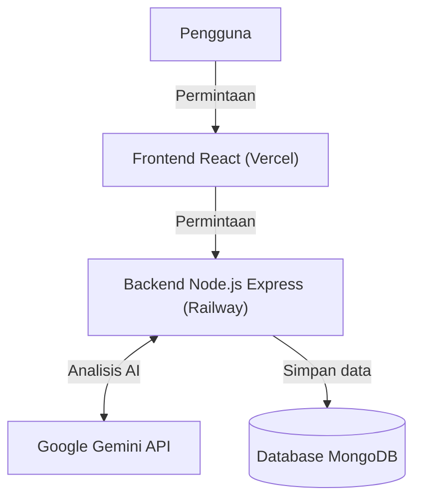
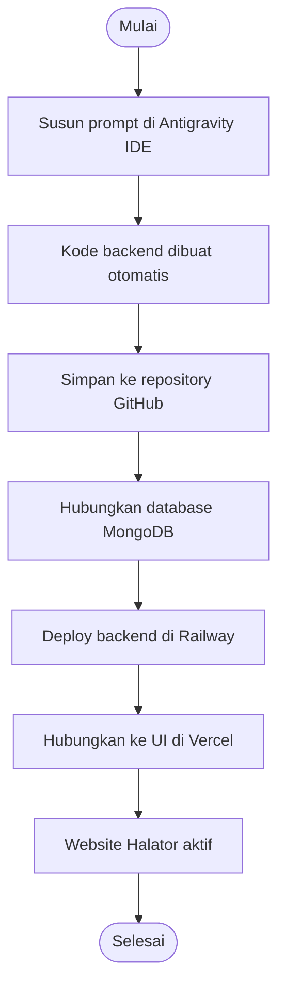
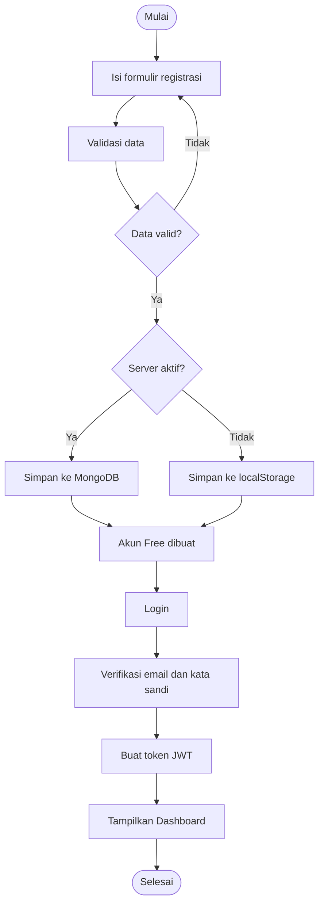
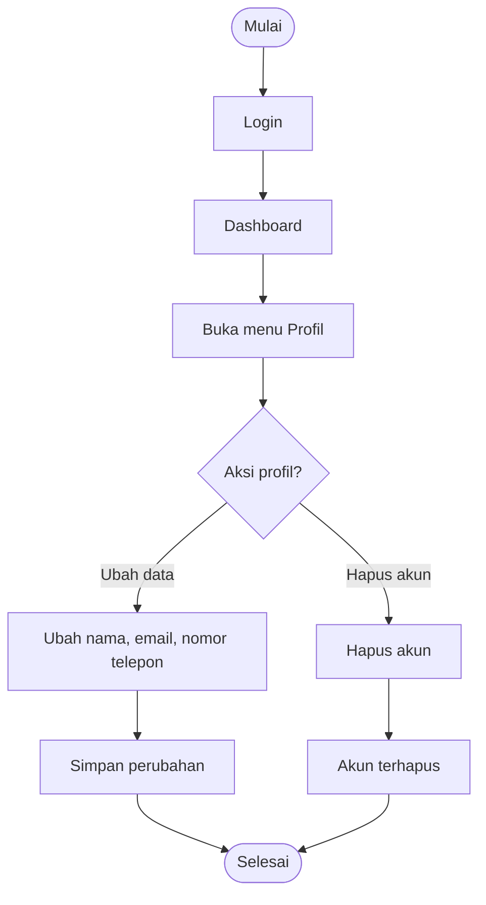

# Halator (Halal Auditor AI)

**Asisten audit kehalalan digital berbasis kecerdasan buatan (AI)** untuk membantu UMKM, praktisi halal, dan masyarakat memeriksa kehalalan produk pangan, proses produksi, dan transaksi keuangan syariah.

🔗 **Website:** https://halator.vercel.app/

> Dokumen ini adalah pendamping **Laporan Praktek Kerja Lapangan (PKL)** berjudul
> *"Pemanfaatan Artificial Intelligence melalui Vibe Coding dalam Pengembangan Website 'Halator' di PT. Kembangin Teknologi Kita"*.
> Setiap diagram di sini sama dengan gambar di **Bab IV** laporan, sehingga mudah dicocokkan.

---

## Ringkasan Singkat

| | |
|---|---|
| **Apa itu Halator?** | Website untuk memeriksa kehalalan **bahan produk**, **proses produksi (standar HAS 23000)**, dan **transaksi syariah** dengan bantuan AI. |
| **Siapa penggunanya?** | Pelaku UMKM, praktisi halal, dan masyarakat umum. |
| **Bagaimana cara kerjanya?** | Pengguna memasukkan data (teks atau foto), AI menganalisis, lalu hasilnya ditampilkan dan disimpan di riwayat. |
| **Bagian yang dikerjakan penulis** | **Backend**: registrasi, login, sesi pengguna, serta pembaruan dan penghapusan data profil. Tampilan (UI) disediakan oleh perusahaan. |
| **Metode pengerjaan** | *Vibe coding*: kebutuhan sistem ditulis sebagai prompt di Antigravity IDE, lalu kode dihasilkan oleh agen AI dan ditinjau penulis. |

---

## Fitur Utama

| Fitur | Fungsi |
|---|---|
| **Audit Produk** | Memeriksa komposisi bahan (ketik manual atau unggah foto label dengan OCR). Setiap bahan diberi status **Halal**, **Haram**, atau **Syubhat** beserta penjelasannya. |
| **Audit Proses Produksi (HAS 23000)** | Mengisi kuesioner 5 area kritis (bahan, fasilitas, proses, pekerja, penyimpanan dan transportasi) atau mengunggah SOP. Hasilnya **Compliant**, **Needs Improvement**, atau **Non-compliant**, dan bisa diekspor ke PDF. |
| **Audit Transaksi Syariah** | Memeriksa unsur **Riba**, **Gharar**, dan **Maysir** pada suatu akad, lalu memberi keputusan **Boleh**, **Dilarang**, atau **Syubhat**. Tersedia chat konsultasi lanjutan. |
| **Edukasi Halal** | Artikel dan pencarian istilah bahan atau fiqh. |
| **Dashboard dan Riwayat** | Statistik audit, tren aktivitas, serta riwayat yang bisa difilter, dicari, dan dihapus. |
| **Akun dan Profil** | Registrasi, login, ubah profil dan data usaha, tema terang atau gelap, bahasa Indonesia atau Inggris. |
| **Paket dan Afiliasi** | Paket Free (5 audit produk per bulan), Pro, dan Enterprise, serta program referral. |

---

## Teknologi

| Lapisan | Teknologi |
|---|---|
| **Frontend (tampilan)** | React, TypeScript, Vite, Tailwind CSS |
| **Backend (dikerjakan penulis)** | Node.js, Express.js, TypeScript, JWT Authentication |
| **Basis data** | MongoDB (Mongoose) |
| **AI** | Google Gemini API, dengan mesin aturan lokal sebagai cadangan |
| **Deployment** | Backend di **Railway**, tampilan di **Vercel** |
| **Alat pengembangan** | Antigravity IDE, GitHub |

---

## Arsitektur Sistem

*(Sama dengan **Gambar 4.1** di laporan)*

Pengguna membuka tampilan React di Vercel. Tampilan meminta data ke backend di Railway. Backend menyimpan data ke MongoDB dan memanggil Google Gemini API untuk analisis AI.

---

## Alur Pengembangan dan Deployment

*(Sama dengan **Gambar 4.2** di laporan; langkah rincinya ada di Bab IV bagian B)*

---

## Alur Registrasi dan Login

*(Sama dengan **Gambar 4.3** di laporan)*

Jika server aktif, akun disimpan di MongoDB. Jika server tidak aktif, data disimpan sementara di `localStorage` sebagai mekanisme cadangan. Setiap akun baru otomatis mendapat paket **Free**. Setelah login berhasil, backend membuat **token JWT** dan pengguna diarahkan ke Dashboard.

---

## Alur Pengelolaan Profil

*(Sama dengan **Gambar 4.4** di laporan)*

---

## Cara Kerja Fitur Audit (Ringkas)

Fitur audit adalah bagian tampilan dan AI milik website. Alur umumnya sama di ketiganya:

1. Pengguna membuka halaman audit dan memasukkan data.
2. Sistem memeriksa kuota audit pengguna.
3. AI (Google Gemini, dibantu aturan lokal) menganalisis data.
4. Hasil ditampilkan, disimpan ke **Riwayat**, dan kuota berkurang satu.

Perbedaan masing-masing:

- **Audit Produk:** input teks atau foto label, hasil berupa status Halal, Haram, atau Syubhat per bahan.
- **Audit Proses:** input kuesioner atau SOP, hasil berupa Compliant, Needs Improvement, atau Non-compliant dan dapat diekspor ke PDF.
- **Audit Transaksi:** input deskripsi akad, hasil berupa keputusan Boleh, Dilarang, atau Syubhat dengan landasan fiqh dan fatwa.

---

## Hubungan dengan Laporan dan Presentasi PKL

| Bagian di dokumen ini | Letak di laporan | Slide presentasi |
|---|---|---|
| Ringkasan dan Fitur Utama | Bab IV bagian A (Projek Saat PKL) | Slide 2 |
| Arsitektur Sistem | Gambar 4.1, Bab IV bagian A | Slide 3 |
| Alur Pengembangan dan Deployment | Gambar 4.2, Bab IV bagian B (Proses Saat Praktek) | Slide 4 |
| Alur Registrasi dan Login | Gambar 4.3, Bab IV bagian C (Hasil) | Slide 5 |
| Alur Pengelolaan Profil | Gambar 4.4, Bab IV bagian C (Hasil) | Slide 5 |
| Hasil, kesimpulan, dan saran | Bab IV bagian C, Bab V | Slide 6 |
| Bukti tangkapan layar proses | Lampiran 21 sampai 28 (Dokumen Penunjang) | Slide 6 (tampilan website) |
| Perbandingan teori dan praktek | Tabel 4.1, Bab IV bagian D | - |

Bukti tangkapan layar yang tersedia di Lampiran: prompt Antigravity IDE (Lampiran 21), repository GitHub (22), basis data MongoDB (23), deployment Railway (24), deployment Vercel (25), environment variables Vercel (26), hasil akhir website (27), dan dashboard setelah login (28).

---

## Catatan Teknis

- Penyimpanan bersifat **hibrida**: data di `localStorage` disinkronkan ke MongoDB melalui REST API saat server aktif.
- Mesin AI memakai **Google Gemini**, dengan **mesin aturan lokal** sebagai cadangan jika offline atau kuota API habis.
- Alamat backend dapat diatur di menu Profil (tab Pengaturan Server). Untuk pengujian lokal dipakai `http://localhost:5000`, sedangkan versi publik memakai backend di Railway.
- Koneksi basis data (*connection string* MongoDB) diatur sebagai *environment variable* pada pengaturan projek di Railway, bukan ditulis di dalam kode.

---

## Penulis

**Jefry Kurniawan**, SMK Muhammadiyah 2 Cibiru, Jurusan Rekayasa Perangkat Lunak (RPL)
Praktek Kerja Lapangan di **PT. Kembangin Teknologi Kita**, 2026
